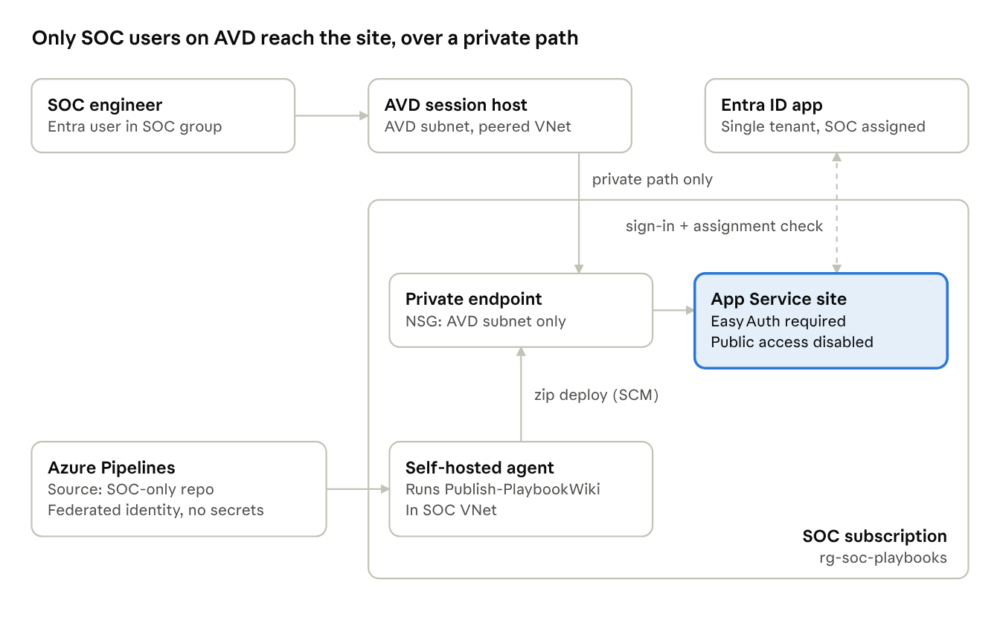

# PlaybooksWikis

**SOC incident playbooks as a private, AI-searchable documentation site on Azure.**
A portfolio project: architecture, code and documentation for a pipeline that validates, secures
and publishes Markdown playbooks, and (phase 1) an agent that answers analysts' questions with
citations to the exact playbook section.

> **This repository is a design and code sample. Nothing here is deployed, and no CI runs from it.**
> All playbooks under `samples/` are **fictional dummy data** written for this project.
> They contain no real company, host, user, tool or incident data and must not be used as real guidance.



## What it shows

| Area | What is implemented or designed |
| --- | --- |
| Content pipeline | PowerShell module, stages F1–F11: inventory, name and content normalization, link rewriting, secret scanning, MkDocs strict build, manifest diff, pre-flight checks, slot deploy and swap, report |
| Security | Fail-closed runs; private endpoint only; Entra single-tenant app with SOC-only assignment; no secrets or IDs in the repo; reports never contain content or secret values |
| AI agent (phase 1) | "Ask the playbooks": tool-using agent over Azure AI Search and Azure OpenAI, cite-or-refuse rule, injection-resistant prompting, evaluation gate in the pipeline |
| Roadmap (phase 2) | Alert-to-playbook triage from Microsoft Sentinel incidents |

Full design: [docs/architecture.md](docs/architecture.md).

## Repository layout

```
src/PlaybookSite/               PowerShell module (Publish-PlaybookSite, Invoke-PlaybookRollback)
tests/PlaybookSite.Tests.ps1    Pester 5 tests (unit + offline end-to-end)
config/playbooksite.config.json Configuration; Azure values are environment-variable placeholders
pipelines/                      Azure Pipelines YAML (reference architecture, not run from this repo)
samples/playbooks/              50 fictional playbooks (dummy data)
samples/eval/                   Golden questions for the agent evaluation (dummy data)
docs/                           Architecture and diagrams
requirements.txt                MkDocs + Material, pinned
```

## Run it locally (offline)

Requires PowerShell 7.4+, Pester 5.5+, Python 3 and `pip install -r requirements.txt`.

```powershell
Invoke-Pester ./tests
Import-Module ./src/PlaybookSite/PlaybookSite.psd1
Publish-PlaybookSite -ConfigPath ./config/playbooksite.config.json -Offline
```

`-Offline` runs F1–F7 (validate, scan, build) with no Azure access and writes the site to `.work/site`
and a report to `.work/report`.

## Configuration

The committed config contains **variable names, not values**. `${NAME}` placeholders are resolved from
environment variables at run time. Unset variables only matter for the Azure stages, which refuse to
start until they are set; offline runs don't need them.

| Variable | Meaning | Naming |
| --- | --- | --- |
| `AZURE_SUBSCRIPTION_ID` | SOC subscription | Azure SDK convention |
| `AZURE_TENANT_ID` | Entra tenant (directory) ID | Azure SDK convention |
| `AZURE_RESOURCE_GROUP` | Resource group holding the site, agent, search and model | Azure Developer CLI convention |
| `PLAYBOOK_SITE_APP_NAME` | App Service app name of the site | Project-specific |
| `PLAYBOOK_SITE_AUTH_CLIENT_ID` | Client ID of the Entra app registration used by Easy Auth | Project-specific |
| `PLAYBOOK_SOC_GROUP_OBJECT_ID` | Object ID of the SOC group assigned to that app | Project-specific |

`AZURE_CLIENT_ID` is deliberately **not** used for the Easy Auth app: Azure Identity reads it as the
identity the code signs in as, so reusing it for a different app would make the two collide.

## Status

| Deliverable | Status |
| --- | --- |
| Content pipeline module F1–F11 + tests | Draft complete |
| Architecture and task definition | Complete |
| 50 dummy playbooks, golden question set | Planned |
| F9a Index, F9b Evaluate, agent API | Planned |
| Bicep for the SOC resource group | Planned |
| Phase 2: Sentinel triage | Roadmap |

## Security notes

- Never commit real playbooks, IDs or secrets. Secret scanning and push protection should stay enabled on this repository.
- The secret scanner's test data uses obviously fake values on purpose.

## License

No license has been chosen yet; until one is added, all rights are reserved.
