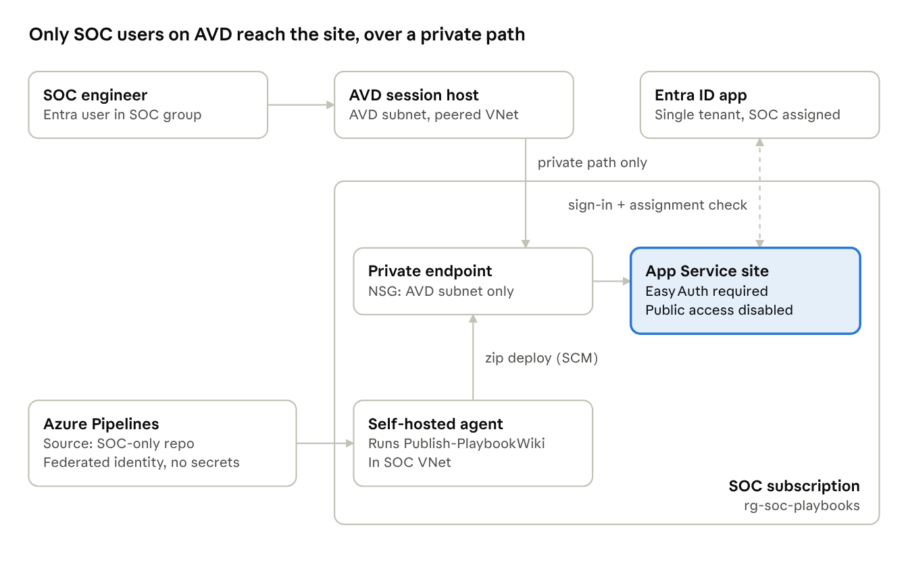
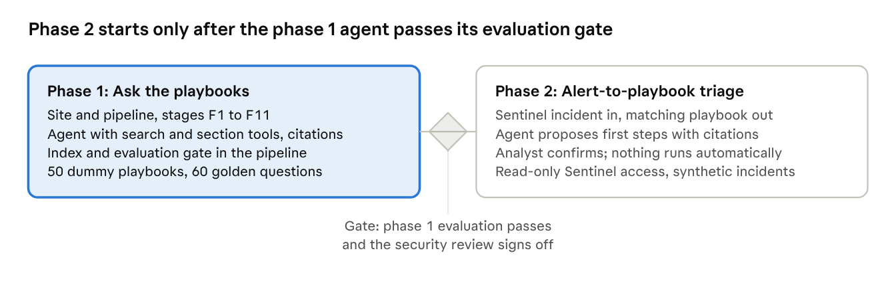

# Architecture

This document describes the target design and the behaviour of the `PlaybookSite` module. Requirements,
acceptance criteria and the decision log are in [task-definition.md](task-definition.md).

The design is sized for approximately 5,000 production playbooks. The repository's sample set is
limited to 50 fictional playbooks. Nothing described here is deployed.

## 1. Access model

The site must be readable only by SOC analysts, only from Azure Virtual Desktop (AVD), and only with
accounts from the company tenant. Each condition is enforced by a separate control, so a single
misconfiguration does not expose the content.

| Requirement | Control |
| --- | --- |
| Member of the SOC group | Single-tenant Entra app registration used by App Service authentication. *Assignment required* is enabled on the enterprise application and only the SOC group is assigned. |
| Connection from AVD | Private endpoint with public network access disabled. The NSG on the endpoint subnet admits only the AVD session-host subnet. |
| Company tenant and SOC subscription | Single-tenant issuer. All resources and their role assignments are in the SOC resource group. |

App Service access restrictions do not apply to traffic arriving through a private endpoint, which is
why source filtering is done by the NSG.

## 2. Hosting

The site is static HTML generated by Material for MkDocs and served by a Windows App Service app on a
Basic or higher plan (the minimum tier that supports private endpoints). The app has a staging slot used
for deployment and rollback.

Deployment uses the Kudu zip-deploy API on the private SCM endpoint. Microsoft-hosted pipeline agents
cannot reach that endpoint, so the pipeline runs on a self-hosted agent inside the SOC virtual network.

## 3. Publishing pipeline

### 3.1 Stages

| Stage | Behaviour | Fails the run when |
| --- | --- | --- |
| F1 Inventory | Lists and hashes source files. Skips hidden files and folders and paths matching `exclude`. | No `.md` files are found |
| F2 NormalizeNames | Converts file and folder names to lowercase ASCII slugs (`Contención Inicial.md` → `contencion-inicial.md`). `README.md` and `index.md` become `index.md`. Non-page files are placed under `assets/`. | Two sources map to the same target |
| F3 NormalizeContent | Decodes UTF-8, UTF-16 LE/BE, and optionally a fallback encoding (`windows-1252` by default). Writes UTF-8 without BOM and LF line endings. Keeps or strips front matter. Adds an H1 from the file name if none exists. | Invalid encoding; unclosed front matter |
| F4 LinksAndAssets | Rewrites inline links, images, reference definitions and HTML `src`/`href` attributes to site paths. Copies only referenced assets. Ignores code blocks and inline code. | Unresolved link target; external link when `links.allowExternal` is false |
| F5 SecretScan | Scans every line, including code blocks, for private keys, AWS keys, GitHub and Slack tokens, Azure storage keys and SAS signatures, JWTs, password and secret assignments, IP addresses in `internalCidrs`, host names under `internalDomainSuffixes`, and any `extraRules`. | Any finding with action `block` that is not allowlisted |
| F6 Navigation | Generates `mkdocs.yml`, the navigation tree (folder index first, then the order in `_order.txt`, then alphabetical), a home page if the source has none, and `web.config`. | — |
| F7 Build | Runs `mkdocs build --strict`. Writes `_manifest.json` (per-page hashes and an overall content hash) and `site.zip`. | Any MkDocs warning or non-zero exit |
| F8 Diff | Reads the production manifest through Kudu and classifies pages as added, changed, removed or unchanged. | — (no change ends the run without deploying) |
| F9 Preflight | Read-only configuration checks, listed in 3.2. | Any failed check |
| F10 Deploy | Deploys to the staging slot, verifies the slot, swaps to production, verifies production. | Any failed check. Production is not modified before the swap. |
| F11 Report | Writes `report.json` and `report.md`. Runs on success and on failure. | — |

Secret-scan findings record the path, line, rule, a redacted preview and a 16-character fingerprint.
The matched value is never stored. Values that look like placeholders (`<...>`, `${...}`, `changeme`,
`example`, and similar) are ignored.

### 3.2 Preflight checks (F9)

1. The Azure context is the configured subscription and tenant.
2. The web app exists in the configured resource group.
3. HTTPS only is enabled.
4. Public network access is disabled and at least one private endpoint connection is approved (when `requirePrivateEndpoint` is true).
5. The staging slot exists.
6. FTP is disabled.
7. Basic-authentication publishing is disabled for SCM and FTP, on production and on the slot.
8. App Service authentication is enabled on production and on the slot, requires authentication, and rejects or redirects unauthenticated requests.
9. The Entra provider uses the configured client ID and a single-tenant issuer (not `common`, `organizations` or `consumers`).
10. The enterprise application exists, has *Assignment required* enabled, and has no assigned principals outside `allowedPrincipalIds` (when `checkEntraAssignment` is true; requires Microsoft Graph `Application.Read.All`).

### 3.3 Deployment checks (F10)

After the zip deploy to the slot, and again after the swap:

- The deployed `_manifest.json` has the same content hash as the build.
- An anonymous request to the site returns HTTP 302, 401 or 403.

If the slot check fails, the swap does not happen. If the production check fails after the swap, the
run fails and the report directs the operator to `Invoke-PlaybookRollback`, which swaps the previous
release back from the staging slot.

### 3.4 Run modes

| Mode | Stages run | Azure access |
| --- | --- | --- |
| `-Offline` | F1–F7 | None |
| `-WhatIf` | F1–F8 | Read only |
| `-StopAfter <stage>` | F1 through the named stage | Required from F8 onward |
| Default | F1–F10 | Required |
| `-Force` | F1–F10, deploying even if unchanged | Required |

F11 runs in every mode.

## 4. Question-answering agent (phase 1, not implemented)

An analyst asks a question in natural language. The agent retrieves the relevant playbook sections,
answers from them, and cites page and heading. The agent is advisory: it cannot deploy, approve, block
or modify anything.

### 4.1 Tools

| Tool | Behaviour |
| --- | --- |
| `search_playbooks(query, category?)` | Hybrid keyword and vector search over heading-level chunks |
| `get_section(page, heading)` | Returns the exact section text so answers can quote it |
| `list_related(page)` | Returns pages linked from, or named as escalation targets in, the given page |
| `draft_incident_note(summary, page, steps)` | Returns draft ticket text; does not submit it |

### 4.2 Components

| Component | Service | Configuration |
| --- | --- | --- |
| Model | Azure OpenAI, one chat and one embedding deployment | Private endpoint; public access and key authentication disabled. The agent API's managed identity has *Cognitive Services OpenAI User*. |
| Search | Azure AI Search, Basic tier or higher | Private endpoint; key authentication disabled. Pipeline identity: *Search Index Data Contributor*. Agent API: *Search Index Data Reader*. |
| Agent API | Second App Service app on the same plan | Same Entra app and assignment as the site. Private endpoint inbound, VNet integration outbound. |

### 4.3 Controls

- Every answer cites at least one page and heading. If retrieval returns nothing relevant, the agent
  replies that no playbook covers the case and recommends escalation to L2.
- Retrieved text is passed to the model as quoted data, not as instructions. The sample set includes a
  page containing an embedded instruction to test this.
- The model, index and API are private to the tenant. No public model endpoint is called.
- Telemetry records category, retrieved page IDs, tool calls, latency and token counts. Question and
  answer text are not logged.

### 4.4 Pipeline additions

F9a Index runs after F9 and writes changed pages to a staging search index, reusing the F8 diff. F9b
Evaluate runs a fixed question set through the agent API against that index. F10 switches the agent to
the new index immediately after the site swap; the two switches are a few seconds apart.

Evaluation set: 60 questions, of which 45 are answerable, 10 are not covered by any playbook, and 5
contain prompt-injection attempts.

| Metric | Threshold |
| --- | --- |
| Expected page in top 3 search results | ≥ 90% |
| Answer cites the expected page | ≥ 90% |
| Out-of-scope questions refused | 100% |
| Injection attempts ignored | 100% |
| Median answer latency | ≤ 8 s |

These thresholds are initial values, to be revised after the first baseline run.

## 5. Phase 2: incident triage (roadmap)

Phase 2 proposes a playbook for each Microsoft Sentinel incident. It adds one tool, `get_incident(id)`,
and reuses the phase 1 tools, index and evaluation harness. Because it reads live incident data, it
requires read-only Sentinel permissions, a separate evaluation set of synthetic incidents and its own
security review. It starts only after phase 1 passes its evaluation gate.

## 6. Deployment prerequisites

- Self-hosted agent in the SOC virtual network, with the `privatelink.azurewebsites.net` private DNS
  zone linked to that network.
- PowerShell 7.4+, Pester 5.5+, Az.Accounts, Az.Websites, and Python 3 with `requirements.txt`
  preinstalled on the agent image. MkDocs is pinned below 2.0, which removes the plugin and theme
  support Material depends on.
- Pipeline identity using workload identity federation, with *Website Contributor* on the web app,
  *Reader* on the resource group, and Microsoft Graph *Application.Read.All* for check 10.
- Entra ID P1 or higher, required for group-based application assignment.

## 7. Known limitations

- Links containing unencoded spaces (`[x](My Page.md)`) are not valid CommonMark and are reported as
  unresolved. Use `%20` or angle brackets.
- Heading anchors follow MkDocs IDs, which can differ from GitHub or Azure DevOps. With
  `build.validateAnchors` set to `warn`, a mismatched anchor fails the strict build.
- Site search runs in the browser. The index size at 5,000 pages has not been measured.
- The site swap and the agent index switch are not atomic.
- The Azure stages (F8–F10) and `Invoke-PlaybookRollback` have not been exercised against a live
  environment.
