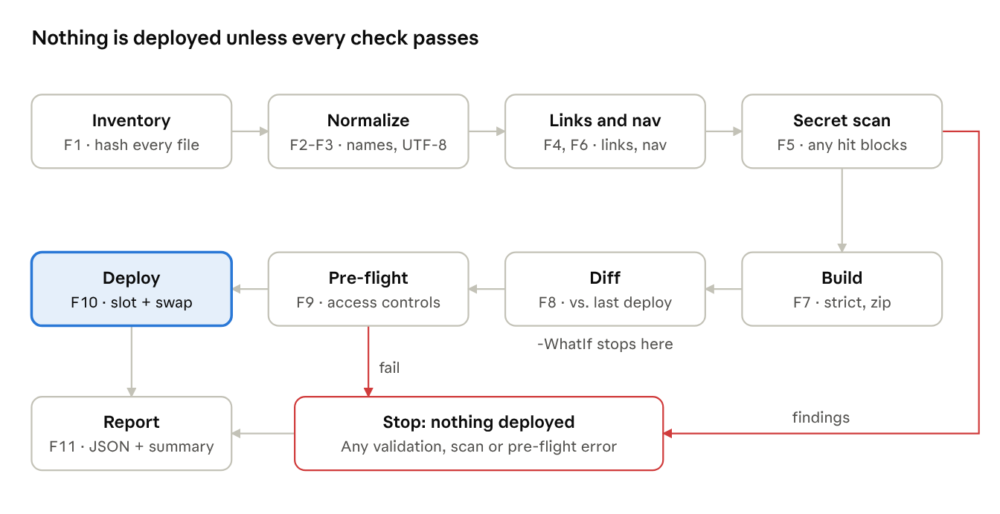
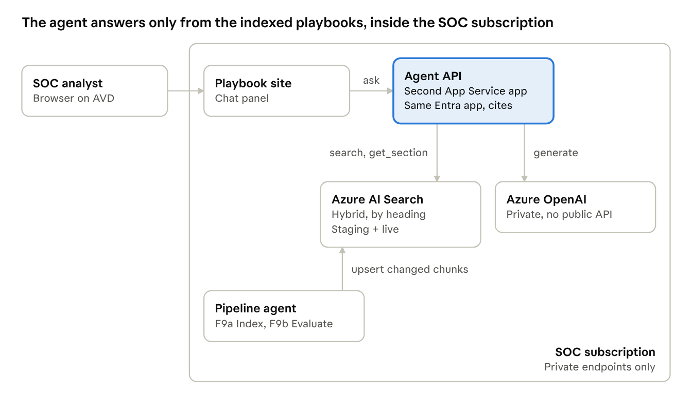

# Architecture

This page summarizes the design. Design decisions and their dates are recorded in the task definition
(`docs/task-definition.md`).

> Sample project: nothing is deployed. All playbooks in `samples/` are fictional dummy data.
> The production design target is about 5,000 playbooks; the sample uses 50.

## Problem

First-level SOC analysts need one searchable, authoritative place for incident-handling playbooks.
Access must be limited by three independent controls:

| Requirement | Enforced by |
| --- | --- |
| Entra user in the SOC group | Single-tenant Entra app for App Service authentication (Easy Auth), *Assignment required*, only the SOC group assigned |
| Access only from Azure Virtual Desktop (AVD) | Private endpoint, public network access disabled, NSG on the endpoint subnet allows only the AVD subnet |
| Company tenant and SOC subscription only | Single-tenant app; every resource and its RBAC in the SOC resource group |

## Target architecture

The site is static HTML generated from the Markdown by MkDocs Material and served by Windows App Service
(Basic tier or higher, required for private endpoints). Deployments go through the private SCM endpoint,
so the pipeline agent is self-hosted inside the SOC VNet.

## Content pipeline

| Stage | What it does | Fails the run on |
| --- | --- | --- |
| F1 Inventory | Lists and hashes source files; skips hidden folders and `exclude` patterns | No pages found |
| F2 NormalizeNames | Slugs every file and folder (`Contención Inicial.md` → `contencion-inicial.md`); README/index → `index.md`; assets → `assets/` | Two sources mapping to one target |
| F3 NormalizeContent | UTF-8 (transcodes UTF-16 and, if configured, Windows-1252), LF line endings, front matter keep/strip, adds a missing H1 | Invalid encoding, unclosed front matter |
| F4 LinksAndAssets | Rewrites inline links, images, reference links and HTML `src`/`href`; copies referenced assets only | Link target not found |
| F5 SecretScan | Keys, tokens, passwords, connection strings, JWTs, internal IPs and host names | Any non-allowlisted `block` finding |
| F6 Navigation | Generates `mkdocs.yml` and nav (index first, then `_order.txt`, then A–Z), home page, `web.config` | — |
| F7 Build | `mkdocs build --strict` (broken links and anchors fail), manifest, zip | Any MkDocs warning |
| F8 Diff | Compares with the manifest in production (read through Kudu with an Entra token) | — (no change = skip deploy) |
| F9 Preflight | Subscription, tenant, private endpoint, public access off, HTTPS only, Easy Auth with a single-tenant issuer on both slots, basic auth and FTP off, assignment required, only approved principals | Any failed check |
| F9a Index *(planned)* | Chunks changed pages by heading, embeds them, writes a staging Azure AI Search index | Indexing error |
| F9b Evaluate *(planned)* | Runs the golden questions through the agent API against the staging index | Any threshold missed |
| F10 Deploy | Zip deploy to the staging slot, slot smoke test (manifest matches, anonymous request refused), swap, production smoke test, then point the agent at the new index | Any failed check; production untouched until the swap |
| F11 Report | Always runs, including on failure; never contains content or secret values | — |

Run modes: `-Offline` (F1–F7, no Azure), `-WhatIf` (stops after F8), full run, and `Invoke-PlaybookRollback`
(swaps the previous release back from the staging slot).

## AI agent, phase 1: Ask the playbooks

An analyst asks in plain language; the agent finds the playbook, quotes the relevant section and cites
page and heading. It advises only: it never deploys, approves, blocks or changes anything.

| Tool | Does |
| --- | --- |
| `search_playbooks(query, category?)` | Hybrid (keyword + vector) search over heading-sized chunks |
| `get_section(page, heading)` | Returns the exact section text, so answers quote instead of paraphrasing |
| `list_related(page)` | Follows links and escalation references |
| `draft_incident_note(summary, page, steps)` | Drafts a ticket note; never submits it |

| Component | Service | Configuration |
| --- | --- | --- |
| Model | Azure OpenAI (chat + embedding deployments) | Private endpoint, public access and key auth disabled; agent API managed identity has *Cognitive Services OpenAI User* |
| Search | Azure AI Search, Basic tier or higher | Private endpoint, key auth disabled; pipeline has *Search Index Data Contributor*, agent API has *Search Index Data Reader* |
| Agent API | Second App Service app on the same plan | Same Entra app and SOC-only assignment; private endpoint inbound; VNet integration outbound |

**Guardrails**

- **Cite or refuse.** Every answer cites a page and heading. With nothing relevant retrieved, the answer is
  "No playbook covers this; escalate to L2". It never improvises containment steps.
- **Playbook text is data.** Retrieved content is passed as quoted context, never as instructions; a planted
  injection page in the dummy set tests this.
- **Same access model as the site**, and everything inside the tenant: no public LLM API.
- **Content-free telemetry:** category, retrieved page IDs, tool calls, latency and tokens only.

**Evaluation gate (F9b).** 60 golden questions over the dummy playbooks, including 10 no playbook covers and
5 injection attempts.

| Metric | Threshold |
| --- | --- |
| Right page in the top 3 search results | ≥ 90% |
| Answer cites the expected page | ≥ 90% |
| Out-of-scope questions refused | 100% |
| Injection attempts ignored | 100% |
| Median answer latency | ≤ 8 s |

Thresholds are starting assumptions, to be tuned after the first baseline.

## Roadmap

Phase 2 adds alert-to-playbook triage from Microsoft Sentinel incidents. It reads live incident data, so it
needs read-only Sentinel permissions, its own golden set of synthetic incidents and a separate security
review. It reuses the phase 1 tools, index and evaluation harness and adds one tool, `get_incident(id)`.

## Requirements for a real deployment

- Self-hosted agent in the SOC VNet with the `privatelink.azurewebsites.net` private DNS zone linked;
  Microsoft-hosted agents can't reach the private SCM endpoint.
- PowerShell 7.4+, Pester 5.5+, Az.Accounts, Az.Websites, Python 3 with `requirements.txt`.
  Keep MkDocs below 2.0: Material warns that MkDocs 2.0 removes plugins and theming.
- Pipeline identity via workload identity federation (no secrets) with *Website Contributor* on the web app,
  *Reader* on the resource group, and Microsoft Graph *Application.Read.All* for the assignment check.
- Entra ID P1 for group-based app assignment.

## Known limits

- Links with unencoded spaces (`[x](My Page.md)`) aren't valid CommonMark and are reported as unresolved.
- Anchors follow MkDocs heading IDs, which can differ from GitHub or Azure DevOps IDs; `validateAnchors: warn`
  makes mismatches fail the build instead of breaking silently.
- Search on the static site is client-side; index size must be measured at the production target of 5,000 pages.
- The site swap and the agent's index switch are two steps, a few seconds apart.
