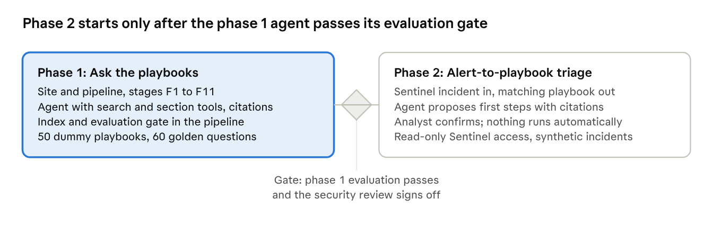
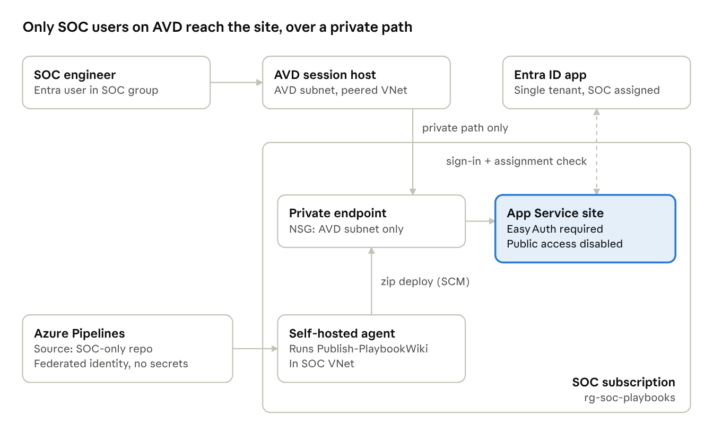
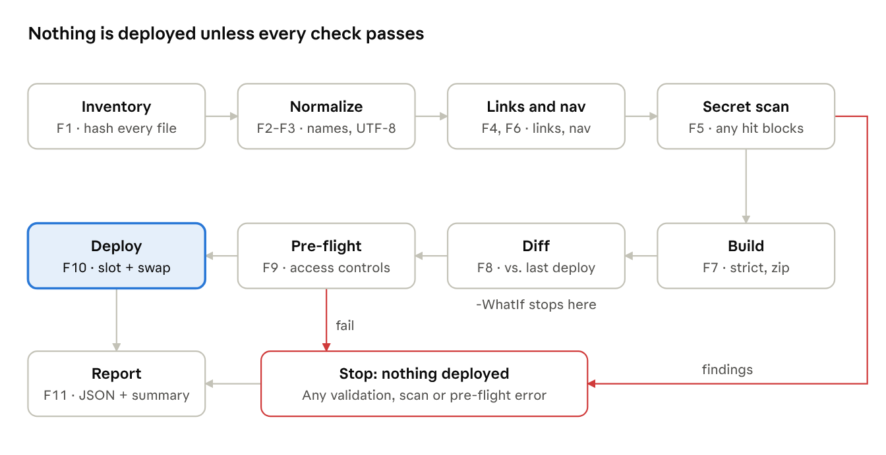
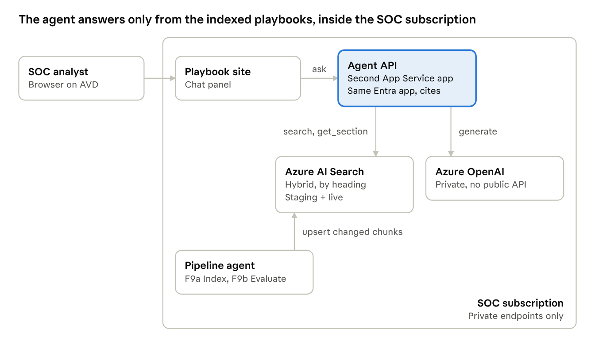

# Task Definition: SOC Playbook Site

| | |
| --- | --- |
| Owner | KaiserinDerWelt |
| Created | 2026-11-23 |
| Status | Design approved; content pipeline and sample data complete; agent and infrastructure not started |
| Related | [architecture.md](architecture.md) |

## 1. Summary

Publish approximately 5,000 Markdown incident-handling playbooks as a static site on Azure App Service in
the SOC subscription. The site is readable only by members of the SOC group, only from Azure Virtual
Desktop, and only with company-tenant accounts. An Azure Pipelines job on a self-hosted agent runs a
PowerShell module that validates and normalizes the content, builds the site and deploys it through a
private endpoint. Access is enforced by Entra application assignment, private networking and the
subscription boundary. The module verifies these controls before deploying but does not configure them.

Phase 1 adds a question-answering agent over the same content. Phase 2 adds playbook suggestions for
Microsoft Sentinel incidents and will be specified separately.

This repository is a reference implementation. It uses 50 fictional playbooks; the 5,000-page figures
below describe the production target.

## 2. Problem statement

First-level SOC analysts need a single, searchable and authoritative source of incident-handling
guidance. The existing playbooks are about 5,000 Markdown files with no consistent conventions for file
names, links, images or front matter.

Three factors make this more than a file copy:

- Volume. All pages must be built and deployed as one versioned unit so that a release can be rolled
  back as a whole.
- Content quality. Broken relative links, missing images, malformed front matter and unsafe file names
  break the build.
- Sensitivity. Playbooks describe detection gaps and response procedures and may contain internal host
  names, IP addresses or credentials. Disclosure to the wrong audience is itself a security incident.

## 3. Decision log

| Date | Decision |
| --- | --- |
| 2026-11-23 | Publishing runs from a pipeline agent self-hosted in the SOC virtual network. |
| 2026-11-23 | Requirement R3b means physical placement: the content must be an Azure resource in the SOC subscription. Azure DevOps Wiki is therefore excluded; the target is App Service. |
| 2026-11-23 | The project is published as a reference implementation. Phase 1 adds the question-answering agent; phase 2 adds Sentinel triage. The sample uses 50 fictional playbooks; no real SOC content is used. |
| 2026-11-23 | The public repository contains structure, code and documentation only. Nothing is deployed and no pipeline runs from it. Configuration holds environment-variable names, never identifiers. Standard Azure names (`AZURE_SUBSCRIPTION_ID`, `AZURE_TENANT_ID`, `AZURE_RESOURCE_GROUP`) are used where they exist; project-specific values use the `PLAYBOOK_` prefix. |
| 2026-11-23 | Agent platform: Azure OpenAI for the model, Azure AI Search for retrieval, a second App Service app for the agent API. |

## 4. Access requirements

| ID | Requirement | Control | Notes |
| --- | --- | --- | --- |
| R1 | User is a member of the SOC group | Single-tenant Entra app registration for App Service authentication; *Assignment required* enabled; only the SOC group assigned | Group-based assignment requires Entra ID P1. Unauthenticated requests are redirected to sign-in. |
| R2 | Access only from AVD | Private endpoint; public network access disabled; NSG on the endpoint subnet allows only the AVD session-host subnet | No public endpoint exists. App Service access restrictions do not apply to private-endpoint traffic, so the NSG is the enforcing control. A Conditional Access policy can be added as a further layer. |
| R3a | Company tenant only | App registration limited to *Accounts in this organizational directory only* | Personal and external accounts fail at sign-in. |
| R3b | Hosted in the SOC subscription | Plan, app, private endpoint, DNS link and agent deployed to a SOC resource group; RBAC on that group limited to SOC administrators and the pipeline identity | |

A SOC user on AVD reaches the private endpoint and signs in. The same user on another network has no
route to the site. A non-SOC user on AVD reaches the endpoint but is refused at sign-in because they are
not assigned to the application.

## 5. Scope

The module owns the content pipeline: validate, build, deploy. Infrastructure (plan, app, private
endpoint, Entra app, agent) is provisioned separately as infrastructure-as-code and only verified by the
module, so a content run cannot widen access.

### In scope

- PowerShell module that validates, normalizes, builds and deploys the playbooks
- File and folder name normalization; navigation generation
- Relative link rewriting; asset collection
- Front matter handling (keep or strip)
- Secret and sensitive-data scanning that blocks deployment on findings
- Static site build with MkDocs
- Zip deployment from the pipeline agent through the private endpoint
- Idempotent runs: deploy only when the content hash changes; retain the previous release for rollback
- Run report (JSON and Markdown) and a `-WhatIf` mode
- Read-only preflight verification of access controls
- Azure Pipelines definition using a workload-identity-federation service connection
- Bicep templates for the SOC resource group
- Phase 1 agent: API, four tools, chat panel in the site, private search index and model endpoint
- Index (F9a) and Evaluate (F9b) pipeline stages, evaluation question set and thresholds
- 50 fictional sample playbooks

### Out of scope

- Authoring or reviewing real playbook content (SOC responsibility)
- Creating the Entra app registration and group assignment (identity administrator, under change control)
- Changes to AVD. VNet peering between AVD and the SOC network is a dependency.
- Azure DevOps Wiki or any target outside the SOC subscription
- Phase 2 (Sentinel triage)
- Any agent action other than advice: no ticket submission, containment or system changes
- Translation, or source formats other than Markdown
- Editorial workflow for SOC leads (recommended follow-up)

## 6. Functional requirements

Stage behaviour as implemented is described in [architecture.md §3](architecture.md#3-publishing-pipeline).

| ID | Stage | Requirement | State |
| --- | --- | --- | --- |
| F1 | Inventory | Scan the source tree; record path, size, encoding and hash of every file | Implemented |
| F2 | Normalize names | Map names to URL-safe slugs; detect collisions; keep a source-to-URL map | Implemented |
| F3 | Normalize content | UTF-8 without BOM, LF line endings; validate or strip front matter; ensure an H1 | Implemented |
| F4 | Links and assets | Resolve and rewrite relative links and images; copy referenced assets; report unresolved targets | Implemented |
| F5 | Secret scan | Detect credentials, keys, tokens, connection strings, internal IPs and host names; block deployment on findings | Implemented |
| F6 | Navigation | Generate site navigation from a configured order or alphabetically | Implemented |
| F7 | Build | Strict build; zip package; per-page content manifest | Implemented |
| F8 | Diff | Compare with the deployed manifest; stop if nothing changed | Implemented |
| F9 | Preflight | Verify subscription, tenant, private networking, authentication settings and Entra assignment | Implemented |
| F9a | Index | Chunk changed pages by heading, embed, write to a staging index; remove deleted pages | Not started |
| F9b | Evaluate | Run the evaluation set against the staging index; fail below any threshold | Not started |
| F10 | Deploy | Deploy to the staging slot, verify, swap, verify; switch the agent to the new index | Implemented except the index switch |
| F11 | Report | JSON and Markdown: counts, rejections, diff, evaluation scores, commit, pipeline run, duration | Implemented except evaluation scores |

F9a, F9b and the agent API make up phase 1. The agent design is described in
[architecture.md §4](architecture.md#4-question-answering-agent-phase-1-not-implemented).

## 7. Non-functional requirements

- PowerShell 7.4 or later on Windows or Linux agents.
- Dependencies: Az.Accounts and Az.Websites for the Azure stages; MkDocs and Material for MkDocs.
  The Entra assignment check calls Microsoft Graph directly. The AzureAD and MSOnline modules are not used.
- Authentication through the pipeline's workload-identity-federation service connection. No personal
  access tokens, client secrets or publishing profiles.
- Pipeline identity permissions: *Website Contributor* on the web app, *Reader* on the resource group,
  Microsoft Graph *Application.Read.All*.
- `SupportsShouldProcess` on every operation that changes state; `-StopAfter` to end a run at a given
  stage.
- Idempotent: a run with no content changes deploys nothing.
- Fail-closed: any validation, scan or preflight error stops the run before deployment.
- Logs and artifacts contain the report only, never playbook content.
- Target: full build and deployment of 5,000 pages in under 20 minutes (to be measured).
- Configuration in a versioned JSON file.
- Pester tests for name mapping, link rewriting and secret detection.

## 8. Acceptance criteria

| # | Criterion | Verification |
| --- | --- | --- |
| 1 | Every source playbook is published or rejected with a logged reason | Report: source pages = published + rejected |
| 2 | No broken internal links or missing images in the built site | Strict build and report |
| 3 | No secrets in published content | Secret-scan section of the report |
| 4 | A SOC member on AVD can read the site | Sign-in test from an AVD session host |
| 5 | A SOC member outside AVD cannot reach the site | Request from another network fails |
| 6 | A non-SOC tenant user on AVD is denied | Sign-in fails: user not assigned |
| 7 | External and personal Microsoft accounts cannot sign in | Sign-in test with an external account |
| 8 | All resources are in the SOC subscription | Resource inventory of the SOC resource group |
| 9 | Only the pipeline identity can deploy; basic-auth publishing and FTP are disabled | Configuration check and a failed deployment attempt with other credentials |
| 10 | A run with no source changes deploys nothing | Run log and report (`NoChanges`) |
| 11 | Every deployment is traceable to a commit, pipeline run and report | Pipeline history and report artifact |
| 12 | The agent meets every evaluation threshold | F9b report |
| 13 | Every agent answer cites a page and heading, or declines | Evaluation report and manual review of 20 sampled answers |
| 14 | The agent API rejects unauthenticated and non-SOC callers | Criteria 5–7 repeated against the API |
| 15 | Agent telemetry contains no question or answer text | Review of the log schema and sampled entries |
| 16 | The public repository contains only fictional playbooks | Review before publication; `dummy: true` in every page |

## 9. Sample data

The sample set consists of 50 fictional playbooks containing no real organization names, hosts,
addresses, users, tools or incidents. Real SOC playbooks never enter the public repository, pipeline
artifacts or evaluation set. The sample is designed to exercise every stage:

- About 10 incident categories with 4–6 playbooks each
- A common section template (detection, triage, containment, eradication, recovery, escalation, owner)
  and a few pages that deviate from it
- Accented and space-containing file names, Windows-1252 and UTF-16 files, CRLF line endings, missing
  H1 headings, relative links and images
- One page containing an embedded instruction to confirm the agent treats retrieved text as data
- Each playbook mapped to MITRE ATT&CK techniques (64 in total, across 11 tactics), with sections aligned
  to the NIST SP 800-61 incident response lifecycle

Inputs that must stop a run are kept in `samples/negative/` rather than in the main set, so that the main
set can be built and indexed: fabricated secrets and a private-range IP address (F5 must block them), and
a name collision (F2 must reject it). Indicators in the main set are defanged and use documentation-reserved
values, so the secret scan does not flag them.

Each playbook carries `dummy: true` in its front matter. See [samples/playbooks/README.md](../samples/playbooks/README.md).

## 10. Risks

### Platform and content

| Risk | Impact | Mitigation |
| --- | --- | --- |
| *Assignment required* disabled on the Entra app | Every tenant user can read the playbooks | Set in IaC; verified by F9 on every run |
| Public network access re-enabled or a temporary access rule added | Site reachable from the internet (still behind sign-in) | Azure Policy denying public network access on the resource group; verified by F9 |
| Source repository or pipeline artifacts less protected than the site | Content bypasses the access controls | Repository restricted to SOC and maintainers; artifacts contain only the report; short retention |
| Self-hosted agent compromised or shared | Deployment rights and content exposed | Dedicated agent pool in the SOC network; least-privilege identity |
| AVD peering or private DNS misconfigured | SOC users cannot reach the site | Private DNS zone linked to the AVD network; criterion 4 |
| Secrets in playbooks | Credential exposure | F5 blocks deployment; SOC remediates |
| Client-side search index too large at 5,000 pages | Slow page loads on AVD | Measure in the first `-WhatIf` run; split the index if needed |
| Name collisions after normalization | Pages overwritten | F2 fails the run |
| Rejected content remains in Git history | Secrets recoverable from the source repository | Scan before first commit; documented history-rewrite procedure |

### Agent

| Risk | Impact | Mitigation |
| --- | --- | --- |
| Agent invents a containment step | Analyst acts on incorrect guidance | Cite-or-decline rule; answers quote `get_section` output; 100% refusal threshold on out-of-scope questions |
| Instruction embedded in playbook text alters agent behaviour | Incorrect or harmful answer | Retrieved text passed as data; injection page and five injection questions in the evaluation set |
| Model, prompt or chunking change degrades quality | Silent regression | F9b thresholds fail the run; scores recorded per run |
| Questions or answers written to logs | Incident details exposed outside the SOC | Content-free telemetry schema; criterion 15 |
| Sample content mistaken for real guidance | Fictional steps used in a real incident | `dummy: true` front matter, banner on every page, README notice |
| Token cost grows with usage | Budget overrun | Per-user rate limit; budget alert on the resource group |

## 11. Assumptions

- The tenant has Entra ID P1 or higher.
- The AVD network can be peered to the SOC network, or the private endpoint can be placed in a subnet
  AVD already reaches.
- A SOC Entra group exists and is maintained by the SOC.
- The SOC subscription permits App Service (Basic or higher), private endpoints and an agent VM or scale set.
- Playbooks are CommonMark-compatible Markdown with local images.
- Azure Pipelines can use a workload-identity-federation service connection to the SOC subscription.

## 12. Dependencies

| Party | Provides |
| --- | --- |
| Identity administrator | Entra app registration, *Assignment required*, SOC group assignment |
| SOC subscription owner | Resource group, RBAC, Azure Policy, approval of IaC deployments |
| Network team | VNet peering to AVD, NSG on the endpoint subnet, private DNS zone link |
| Azure DevOps administrator | Service connection, dedicated agent pool, SOC-only source repository |
| SOC lead | Content ownership, exclusion list, remediation of secret findings |

## 13. Open questions

1. Azure OpenAI region: which region offers the required chat and embedding models with quota, and is it
   acceptable for SOC data residency?
2. Site generator: MkDocs Material (current implementation; requires Python on the agent) or DocFX
   (.NET)?
3. Private endpoint (current implementation) or public endpoint with an AVD IP restriction?
4. Agent hosting: single VM, Managed DevOps Pool or scale set?
5. Direct deployment, or an approval gate signed off by a SOC lead?
6. Long-term source of the playbooks: a SOC-only Azure DevOps repository, or an upstream system the
   pipeline synchronizes from?
7. Front matter: strip, or render as page metadata (owner, severity, last review date)?
8. Navigation: a mandated structure (by incident type or severity), or alphabetical?
9. Which internal patterns are sensitive (domain suffixes, IP ranges, ticket formats)?
10. Should page reads be logged per user to the SOC Log Analytics workspace?

## 14. Deliverables

| # | Deliverable | State |
| --- | --- | --- |
| 1 | `PlaybookSite` PowerShell module with sample configuration | F1–F11 implemented; F9a and F9b not started |
| 2 | Azure Pipelines definition | Written (reference only) |
| 3 | Bicep for the SOC resource group: plan, app, slot, private endpoint, NSG, DNS link, agent, search, model, policy assignment | Not started |
| 4 | Pester test suite | Implemented (44 tests) |
| 5 | Setup runbook: Entra app and assignment, peering, RBAC, first deployment | Not started |
| 6 | Report from the first `-WhatIf` run against the sample playbooks | Not started |
| 7 | Evidence for acceptance criteria 4–9 and 14 | Not started |
| 8 | Agent API with four tools and the site chat panel | Not started |
| 9 | 50 fictional playbooks in `samples/playbooks/` | Complete |
| 10 | Evaluation set (60 questions) and baseline report | Question set complete; baseline report pending F9b |
