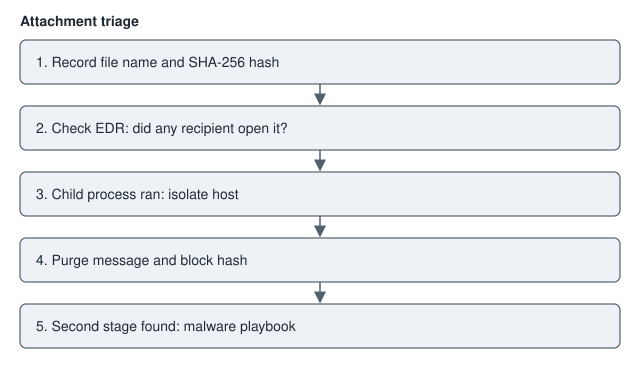

# Malicious attachment

> **Fictional sample.** Written for a reference implementation. Not operational guidance.

A user received, and possibly opened, an email attachment that runs code: a macro-enabled document, an archive containing a script, or a disk image.

| Field | Value |
| --- | --- |
| ID | PB-PHI-002 |
| Severity | High ([definitions](../escalation-matrix.md#severity-levels)) |
| Lifecycle | [NIST SP 800-61 phases](../incident-response-lifecycle.md) |

## MITRE ATT&CK mapping

| Tactic | Technique |
| --- | --- |
| [Initial Access](https://attack.mitre.org/tactics/TA0001/) (TA0001) | [T1566.001 Phishing: Spearphishing Attachment](https://attack.mitre.org/techniques/T1566/001/) |
| [Execution](https://attack.mitre.org/tactics/TA0002/) (TA0002) | [T1204.002 User Execution: Malicious File](https://attack.mitre.org/techniques/T1204/002/) |
| [Execution](https://attack.mitre.org/tactics/TA0002/) (TA0002) | [T1059.005 Command and Scripting Interpreter: Visual Basic](https://attack.mitre.org/techniques/T1059/005/) |

## Detection

- Email gateway sandbox verdict on an attachment.
- EDR alert for an Office application starting a script interpreter.
- User report of a document asking to *Enable content*.

## Triage

1. Record the attachment's file name and SHA-256 hash.
2. Determine whether any recipient opened it: EDR process tree for the Office application or archive tool.
3. If a child process ran, collect its command line and any network connections it made.

## Containment

1. Purge the message from all mailboxes and block the hash on the gateway and EDR.
2. Isolate every host where the attachment executed.
3. Block any domains or IP addresses the payload contacted.

## Eradication

- Remove dropped files and persistence entries identified in the process tree.
- If a second-stage payload ran, continue with [Commodity malware detection](../Malware/Commodity%20malware%20detection.md).

## Recovery

- Release the host from isolation after a clean full scan.
- Reset the user's password if the payload had credential-theft capability.

## Escalation

Escalate according to the [escalation matrix](../escalation-matrix.md) when:

- The payload established command-and-control traffic.
- More than one host executed the attachment.

## Owner

Email security lead, SOC level 2. Last reviewed 2026-11-20.

## Related playbooks

- [Commodity malware detection](../Malware/Commodity%20malware%20detection.md)
- [Malicious PowerShell execution](../Malware/Malicious%20PowerShell%20execution.md)
