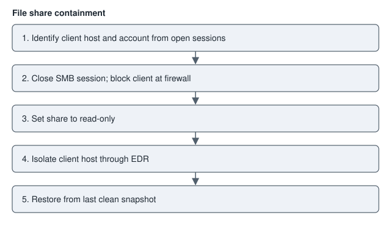

# Mass file encryption on file share

> **Fictional sample.** Written for a reference implementation. Not operational guidance.

A file share is being encrypted, usually from a single workstation writing over SMB.

| Field | Value |
| --- | --- |
| ID | PB-RAN-004 |
| Severity | Critical ([definitions](../escalation-matrix.md#severity-levels)) |
| Lifecycle | [NIST SP 800-61 phases](../incident-response-lifecycle.md) |

## MITRE ATT&CK mapping

| Tactic | Technique |
| --- | --- |
| [Impact](https://attack.mitre.org/tactics/TA0040/) (TA0040) | [T1486 Data Encrypted for Impact](https://attack.mitre.org/techniques/T1486/) |
| [Lateral Movement](https://attack.mitre.org/tactics/TA0008/) (TA0008) | [T1021.002 Remote Services: SMB/Windows Admin Shares](https://attack.mitre.org/techniques/T1021/002/) |

## Detection

- File server alert for a high rate of renames or writes from one session.
- Users report that documents on a shared drive will not open.

## Triage

1. Identify the client host and account from the file server's open-session list.
2. Estimate the scope: which shares and how many files.

## Containment

1. Close the offending SMB session and block the client host at the firewall.
2. Set the affected share to read-only.
3. Isolate the client host through EDR.

## Eradication

- Investigate the client host as the possible patient zero.

## Recovery

- Restore the share from the last snapshot taken before the first encrypted write.
- Compare file counts and hashes on a sample before reopening the share.

## Escalation

Escalate according to the [escalation matrix](../escalation-matrix.md) when:

- Always.

## Owner

Ransomware response lead, SOC level 2. Last reviewed 2026-11-20.

## Related playbooks

- [Initial containment (Contención inicial)](Contenci%C3%B3n%20inicial.md)
- [Recovery and restoration](Recovery%20and%20restoration.md)
