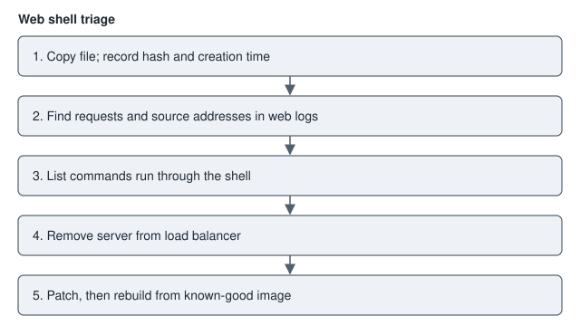

# Web shell discovered

> **Fictional sample.** Written for a reference implementation. Not operational guidance.

A script on a web server lets an attacker run commands through HTTP requests.

| Field | Value |
| --- | --- |
| ID | PB-VUL-002 |
| Severity | Critical ([definitions](../escalation-matrix.md#severity-levels)) |
| Lifecycle | [NIST SP 800-61 phases](../incident-response-lifecycle.md) |

## MITRE ATT&CK mapping

| Tactic | Technique |
| --- | --- |
| [Persistence](https://attack.mitre.org/tactics/TA0003/) (TA0003) | [T1505.003 Server Software Component: Web Shell](https://attack.mitre.org/techniques/T1505/003/) |

## Detection

- EDR alert for a web server process starting a command shell.
- File integrity monitoring detects a new script in the web root.

## Triage

1. Copy the file for analysis and record its hash and creation time.
2. Search web logs for requests to the file and the source addresses.
3. Identify commands run through the shell from EDR telemetry.

## Containment

1. Block the source addresses and remove the server from the load balancer.

## Eradication

- Find and patch the vulnerability that allowed the upload.
- Search all web servers for the same hash and for similar files.

## Recovery

- Rebuild the server from a known-good image.

## Escalation

Escalate according to the [escalation matrix](../escalation-matrix.md) when:

- Always.

## Owner

Vulnerability response lead, SOC level 2. Last reviewed 2026-11-20.

## Related playbooks

- [Public-facing application exploit](Public-facing%20application%20exploit.md)
